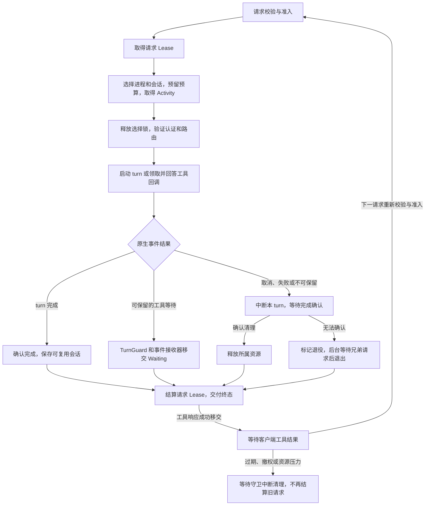

# 后端模块与维护边界

项目保持单个 Rust 服务、单个运行数据目录和 React 管理界面。模块化在进程内完成，管理 API 和客户端协议仍使用现有入口。

Codex Relay（Codex 中转站）的 Rust 源码位于 `crates/relay/`，crate 导入前缀为 `codex_relay`。命名约定见 [项目名称与图标](#项目名称与图标)。

## 开发阶段约定

项目尚未正式发布，接口、配置、公共导入路径和数据库格式按当前设计直接调整，不保留旧开发版本的兼容层或迁移路径；修改时同步更新调用方、测试和文档。文档只描述当前实现与使用方法，不保留已失效的操作步骤、修复日记或阶段性验收记录。

数据库启动时初始化空库或校验当前结构。校验失败会报错并保留数据，程序不自动清空或重建；需要重新初始化开发数据时，先停止服务并备份，再由管理员处理。

## 原生安装与身份检测

`installation.rs` 负责自动检测桌面、校验独立 Codex 路径及保存安装配置。桌面归档从 `package.json.main` 定位启动目录，按内容寻找唯一的客户端初始化声明，排除 `node_modules`，最多扫描 256 个脚本、总计 128 MiB；不执行归档脚本。目录或分块文件改名不要求固定文件名适配，声明结构未知或有歧义时明确报错。独立模式只校验 Codex 版本与初始化协议，不要求桌面或 ASAR。Linux 提供托管安装和独立模式：`installation/managed/` 下载、校验和管理官方二进制，启用时复用独立安装校验；手动路径也可通过 `prepare --codex-path` 配置。Linux 不自动发现桌面，诊断不调用 Windows 工具。安装检测及诊断入口见 [开发检查](DEVELOPMENT-CHECKS.md#安装识别与诊断界面)。

## Operations：调度与运行记录

独立图片入口位于 `images.rs`，传输选择位于 `profiles/images.rs`，结算位于 `operations/images.rs`。兼容请求优先进入 `profiles/native_tools.rs` 的原版工具会话；参数不兼容或准备阶段确认工具不可用时，在原生 turn 发出前选择 `profiles/standalone.rs` 的认证加 HTTP 直连。图片复用 Key、分组、能力开关与并发调度；原生工具使用独占槽位并在图片完成后停止进程，不重放未知结果。默认记录不保存图片正文；请求原文调试开启时按客户端请求及响应的采集规则限长保存，见 [请求原文调试](DEVELOPMENT-CHECKS.md#请求原文调试)。

外部调用方继续从 `codex_relay::operations` 导入 `Operations`、`Lease`、配置和查询类型。`operations.rs` 只声明子模块、导出公共类型，并保存跨模块共享的状态结构。子模块保持私有；原有 `runtime` 公共路径保留。

桌面独立搜索入口位于 `search.rs`，传输分支位于 `profiles/search.rs`。`upstream/bindings.rs` 以独立搜索命名空间固定账户及传输模式，只保存路由摘要。原生搜索在线程内保留引用，`warm::Worker` 的 tool_session 与 Responses 会话隔离，受同一进程池容量、空闲和健康回收边界约束；同一 Key/分组/会话/参数串行执行并验证完整上下文相同或追加。已绑定的搜索会话沿用保存的传输模式，引用会话失效后明确报错，不换路径。API Key 和不兼容独立参数使用直连。`client_api.rs` 的已认证 fallback 负责记录未知路径/错误方法拒绝。

| 文件 | 修改什么功能时查看 |
| --- | --- |
| `operations/storage.rs`、`schema.rs`、`schema.sql` | 数据目录独占锁、SQLite 打开、当前结构初始化与校验、重启后的中断恢复 |
| `operations/settings.rs` | 账户与分组策略、代理/并发/队列配置、revision 校验、管理状态快照 |
| `operations/activation.rs` | 账户启用状态、保留路由配置、停用后的空闲等待与维护容量验证 |
| `operations/admission.rs` | 路由选择、权限与容量判断、公平入队、请求记录创建、即时占额 |
| `operations/scheduler.rs`、`scheduler/` | 综合评分、探索、原生账户亲和绑定、准入续期与失效、父线程继承及对应测试 |
| `operations/queue.rs` | 排队查询、管理员取消、服务退出、等待唤醒、出队占额、等待任务丢弃 |
| `operations/lease.rs` | 执行完成记录、释放额度、未完成租约被丢弃时的取消记录 |
| `operations/history.rs` | 请求历史筛选与分页、汇总与趋势、空闲时清空历史 |
| `operations/request_content.rs` | 失败请求参数与响应的脱敏、裁剪及按需读取 |
| `debug_capture.rs`、`operations/debug_content.rs` | 可选请求原文采集、按调试版本写入、关闭或重启后的清理；不参与续聊恢复 |
| `operations/api_keys.rs` | API Key 创建与修改、认证与授权 |
| `operations/inference.rs` | 推理路由管理、用量字段与汇总、模型执行结果记录 |
| `operations/telemetry.rs` | 执行阶段、时延、交付与清理结果 |
| `operations/runtime.rs` | 原生模型能力目录、账户健康状态、冷却与能力校验 |
| `operations/rate_limit.rs` | ChatGPT 登录账户的短期限流退避、账户隔离及单请求恢复探测；API 账户排除 |

## 状态一致性约束

- `Operations::inner` 中的配置、活动请求、等待队列、轮询游标和数据库写连接共享同一把锁。容量检查与占用、取消与出队、账户迁组与请求准入必须在同一个临界区完成。
- 持有这把同步锁时，不执行原生进程启动、模型请求或其他异步等待。等待者先注册通知，再检查容量，避免错过完成通知。
- 调度路径先写请求记录，再发布活动或排队状态。结算和取消沿用现有的存储失败处理；退出时即使写入失败，也必须释放等待者。
- `Lease` 和等待者的 `Drop` 负责清理未完成工作。修改这些路径时同时检查正常完成、取消、超时和任务被丢弃的情况。
- 已配置路由的账户可分配多个客户端执行租约；登录、凭据导入与原生维护租约保持账户级互斥。冷却恢复阶段额外限制一个探针请求，不依赖账户并发值等于1。

- 数据库由 `storage.rs` 打开，`schema.rs` 初始化并校验当前结构，建表定义位于 `schema.sql`；增加字段时同步更新定义与校验，不在查询路径临时建表。
- 历史统计与账户用量使用独立的 SQLite 只读连接，在 WAL 读事务中取得一致快照；读取不访问 `Inner`。管理接口先异步排队再进入后台阻塞线程，最多一个统计任务执行。所有调度与写入仍共用 `Inner` 锁。
- 自动历史清理在后台线程中分批执行，每批最多 1,000 条并释放调度锁。接收请求不触发清理；手动修改保留天数仍在同一事务内保存设置并立即清理。
- 模块之间的内部辅助方法最多使用 `pub(super)`，不因拆文件扩大对外 API。

模块拆分不改变调度状态的锁顺序与一致性约束。只读历史快照与调度写入分离，但容量检查、记录写入和状态转换仍在同一临界区内完成。

软账户亲和的建立和续期位于请求记录写入成功后的准入临界区，不能在响应完成时回写。绑定按 Key、模型和对话身份隔离，分组变化后仍须重新校验账户授权；父线程提示只能影响首次账户选择。亲和设置持久化，绑定仅保存在内存中；详细规则见 [多账户智能调度](OPERATIONS.md#多账户智能调度)。

### 账户内执行器池

`profiles/pool.rs` 管理账户的有界进程槽位，`profiles/shared.rs` 协调共享 Responses。账户准备锁和槽位锁覆盖进程选择、必要的启动、会话领取及预算预留；释放前必须取得活动读租约。`prepare_shared_route` 在释放选择锁后读取认证和配置，同一次 `config/read` 的快照用于路由校验与摘要。完整历史匹配在锁外计算，领取时复核快照，防止并发请求消费或延长同一会话。

每个启用的原生账户预热并保留一个已认证、路由已校验的实例，不发送模型请求；额外实例按空闲策略回收，进程池受账户并发高水位限制。后台仅在账户空闲且仍允许接入时补齐常驻实例。资源不足只拒绝新预留，已预留请求仍可完成。线程、字节、工具等待及目录轮换上限统一见 [缓存与资源边界](NATIVE-CACHE-CAPABILITIES.md#按资源压力回收)。

原生长会话、独立图片和搜索使用各自的独占执行路径；显式压缩复用 `profiles/standalone.rs` 的账户认证与清理，通过 HTTP 转发，正文只经过内存。账户检查仍使用主槽，由调度层的维护互斥防止覆盖客户端请求。

### 请求执行与资源移交

普通 Responses 的入口和 HTTP/WS 交付位于 `responses.rs`；原生执行协调位于 `responses/execute.rs`，准备和事件收集分别位于 `execute/prepare.rs`、`execute/stream.rs`。HTTP 响应结束、原生 turn 完成、原生 thread 关闭是三个不同的边界。

准备阶段仅按现有条件重试；一旦发出原生 turn 或工具结果，结果未知也不能重放。工具续接必须先取得新请求额度、确认所有权并校验整批结果，再更新允许的逐轮设置。设置更新前、更新完成后及首个回调写入前均检查等待状态；准备期间已结束、产生新输出或发生压缩的轮次不能接收旧工具结果。账户软亲和只用于选路，不能授权领取线程。

| 资源 | 持有者及获取时机 | 移交与释放条件 |
| --- | --- | --- |
| 请求并发额度 `operations::Lease` | 准入时原子占额，交给请求任务 | 正常结算或 `Drop` 释放；工具等待期不占请求额度 |
| 账户取消注册 | 每个执行任务独立注册；保留的工具等待也登记 | 随任务或等待状态清理，不删除兄弟请求注册；账户停止先阻止新注册并取消全部记录，再等待执行器 |
| 进程读租约 `warm::Activity` | 选择锁释放前取得 | 可随 `TurnGuard` 跨请求持有；退役需要等待所有读租约释放，不能为单请求杀死共享进程 |
| 原生 turn `TurnGuard` / `Waiting` | 发出 turn 或原子领取工具等待状态 | 确认完成后 `disarm` 移交保护；丢弃时异步中断并清理，期间继续持有 Activity |
| 交付票据 `Handoff` | 保留工具等待后，在交付终态前发布 | 允许后续请求领取；交付失败或未完成票据被丢弃时撤销等待状态 |
| 线程预算 `resources::Reservation` | 选择会话时预留，随后绑定线程 | 只有确认线程关闭才归还账本容量；未完成的预留被丢弃时退役所属进程 |
| 会话目录 `Worker.directory` | 启动进程时创建，各线程使用子目录 | 进程树退出后统一释放；线程卸载不提前删除目录 |

`profiles/resources.rs` 的账本状态如下。每次预留递增 Token 版本，旧任务的迟到清理不能释放新持有者的容量。所有状态均计入线程及字节预算；预算只累计新增输入、工具结果和去重输出，不等于 RSS，也不猜测自动压缩释放的字节数。

| 状态 | 含义 | 后续转换 |
| --- | --- | --- |
| `Reserved` | 已占预算，尚在准备 | 绑定线程后进入 `Running`；准备失败由预留守卫触发退役 |
| `Running` | 当前请求正在执行 | 可保留会话进入 `Idle`，工具移交进入 `Waiting`，其余进入 `Closing` |
| `Idle` | 已完成且可复用，也是普通 LRU 回收候选 | 再次领取进入 `Reserved`；回收进入 `Closing` |
| `Waiting` | 原生 turn 等待客户端工具结果 | 再次领取进入 `Reserved`；过期、撤权或资源压力触发中断清理 |
| `Closing` | 清理已开始，仍占预算 | 确认关闭后移除；失败则退役进程，不提前返还容量 |

RPC 通知和工具回调按 threadId 隔离。`TurnGuard` 从执行、工具等待到清理始终持有原始事件接收器，清理被取消时也不丢弃已排队的完成证据。取消发送 `turn/interrupt`，以 threadId 和 turnId 均匹配的 `turn/completed` 确认结束；即使中断回执失败或缺失，已确认的完成事件仍有效。线程卸载须收到 `thread/closed` 或通过完整分页的 `thread/loaded/list` 确认已不存在。仅有 RPC 成功回执不足以释放通道、回调索引或预算。无法确认时退役进程并等待兄弟请求；后台清理也持有账户注册和活动保护。

| 需要保持的约束 | 定向回归位置与用例 |
| --- | --- |
| 工具结果继续同一 turn，设置失败不回答或重放 | [continuation/tests.rs](../crates/relay/src/responses/continuation/tests.rs)：`tool_results_resume_the_same_turn_and_usage_is_per_response`、`rejected_or_unavailable_settings_never_answer_tools_or_replay` |
| 工具续接准备期间发生终态、输出或压缩时不提交旧回调 | [continuation/pre_submit_tests.rs](../crates/relay/src/responses/continuation/pre_submit_tests.rs)：`queued_invalidation_during_resume_preflight_never_answers_old_callbacks` |
| 清理沿用原接收器，精确终态优先于中断回执 | [continuation/tests.rs](../crates/relay/src/responses/continuation/tests.rs)：`cancelled_cleanup_attempt_keeps_its_original_notification_receiver`、`terminal_confirmation_wins_over_a_rejected_or_missing_interrupt_reply` |
| 未交付的工具等待先完成中断清理，再关闭上下文 | [profiles/shared/tests.rs](../crates/relay/src/profiles/shared/tests.rs)：`cancelled_uncommitted_tool_wait_is_cleaned_before_context_close` |
| 取消、线程关闭或未完成压缩不进入复用池 | [compaction_reuse_tests.rs](../crates/relay/src/responses/compaction_reuse_tests.rs)：`unconfirmed_compaction_or_closed_thread_never_enters_the_reuse_pool` |
| 交付失败撤销、并发领取拒绝、等待过期不续命 | [profiles/continuations.rs](../crates/relay/src/profiles/continuations.rs)：`uncommitted_delivery_is_revoked_and_success_detaches_cancellation`、`unpublished_or_claimed_continuations_reject_a_second_consumer`、`expiration_cannot_be_extended_by_an_invalid_claim` |
| 旧 Token 不能释放新预留，超额线程关闭后才返还容量 | [profiles/resources.rs](../crates/relay/src/profiles/resources.rs)：`counts_live_contexts_and_fences_late_cleanup`、`oversized_input_runs_alone_then_releases_only_after_close` |
| 单请求取消与账户停止的范围不同 | [profiles/pool.rs](../crates/relay/src/profiles/pool.rs)：`cancellation_and_registration_are_per_request_but_stop_covers_account` |
| 取消订阅回执不代表关闭，分页确认不影响兄弟线程 | [rpc/reclamation.rs](../crates/relay/src/rpc/reclamation.rs)：`acknowledgement_without_shutdown_times_out_and_keeps_channel`、`confirmation_uses_all_pages_and_cleans_only_its_own_channel` |

## Responses：逻辑身份与线程复用

`responses/affinity.rs` 生成账户选路摘要，`responses/affinity/identity.rs` 从请求体、turn metadata 和请求头提取逻辑线程、会话及明确父线程身份。HTTP 和 WebSocket 逐帧请求使用相同身份规则；冲突或缺少独立身份的子线程不能领取已有聊天状态。父线程、缓存选路键和历史前缀不能替代线程或工具回调授权。

`responses/reuse.rs` 的历史指纹属于客户端已提交和已收到的完整记录；`responses/reuse/context.rs` 单独跟踪原生压缩开始、完成及检查点。确认压缩后的线程可以继续对应同一客户端记录，只注入新增内容，不将客户端旧历史重新写回压缩后的原生上下文。检查点参与会话快照相等校验，未完成或不一致的压缩不能进入复用池。工具等待期由 `Waiting::unchanged` 在后台检查、原子领取和工具结果提交前检查异常上下文变化；失效状态持续保留，不能因触发事件已被消费而重新领取。清理由原有 turn 所有权守卫负责。

`responses/reuse.rs` 区分线程稳定设置与逐轮设置，完成轮次之间可由下一次 `turn/start` 应用推理强度、摘要、服务等级和 JSON Schema 变化；同时追加新 system/developer 消息不改写旧历史。工具待答期间仅允许经官方 `turn/settings/update` 确认的强度、摘要和服务等级变化，其余设置严格匹配。请求额度、所有权和全部工具结果校验必须先就绪，设置更新成功后才能回答回调。线程与回调复用继续校验 Key、账户、逻辑身份、完整历史及当前分组授权。同一 Key 改分组后，只要原账户和模型仍获授权，可续用存活线程与工具回调。工具等待期按当前 Key 权限检查，已准入请求仍使用其原授权快照；新请求按新分组准入和结算。WebSocket 连接缓存按 Key 归属，改分组不清空，撤销或删除 Key 仍清理缓存。`response.steer` 在入队及实际执行时复核该轮的准入授权快照，换组后不能向旧分组记账的在途轮次追加输入；新轮次重新准入。参数恢复和回退条件见 [Responses 接入](RESPONSES.md#原生传输与兼容范围)及 [官方能力对照](NATIVE-CACHE-CAPABILITIES.md)，相关回归位于 `responses/reuse_tests.rs`、`responses/turn_settings_tests.rs` 与 `responses/continuation/tests.rs`。

完成轮次后的模型切换通过 `turn/start.model` 实现，要求显式推理强度以及完整历史匹配。共享进程保留启动时已净化模型目录的集合；新模型不在集合中时，只在准备阶段退役并重建进程，避免原生 fallback 恢复宿主工具。切换后不保留旧模型默认强度；工具待答期间仍严格匹配模型。

## Admin：管理接口与服务生命周期

`admin.rs` 保留 `AdminState`、共享的 revision 输入类型和统一路由注册表。领域处理函数位于私有子模块，注册表通过 `pub(super)` 引用处理函数及其请求类型。`router`、`authorize`、`run_job`、`serve`、`serve_with_network`、`Job` 和 `AdminState` 的公共导入路径不变。

| 文件 | 修改什么功能时查看 |
| --- | --- |
| `admin/access.rs` | 管理令牌校验、会话状态、Host/Origin 与后台登录检查 |
| `admin/accounts.rs` | 创建与删除账户、启停、登录与凭据绑定、维护操作的结算 |
| `admin/activation.rs` | 账户主开关、等待任务完成后停止实例、停用账户的维护操作 |
| `admin/routing.rs` | 路由启用、连接测试、账户/分组检查、模型能力验证 |
| `admin/api_keys.rs` | 密钥管理接口、客户端接入地址展示 |
| `admin/operations.rs` | 调度设置、分组与账户策略、队列操作、请求历史和统计接口 |
| `admin/diagnostics.rs` | 管理概览、桌面调试、诊断任务及报告 |
| `admin/native_runtime.rs`、`installation/managed/` | Linux 官方 Codex 检查、代理下载、完整性校验、版本启用和手动删除 |
| `admin/server.rs` | 监听器启动、停止请求、信号处理与服务退出顺序 |

注册表继续在同一位置给受保护的管理路由应用 `authorize` 和请求体大小限制。会话状态与登录入口、客户端 `/v1` 路由，以及最外层公网策略与安全响应头，保留各自原有边界。增加管理接口时，应把处理函数放入对应领域文件，再在受保护路由链中注册。

停止接口只发出取消信号，统一退出流程负责取消推理、释放等待队列、等待请求和任务结束，再停止桌面调试与账户进程。停止账户、取消登录和登出使用原有维护租约逻辑，不能因调度暂停或额度占满而失去清理能力。

## Profiles：账户存储、认证与原生 Worker

`profiles.rs` 保留公开的 `Profile`、`ProfileView`、`Profiles` 类型、账户状态、共享 Worker 槽位及推理注册清理守卫。模块沿用同一份记录、槽位、删除锁、推理取消表和模型目录刷新状态。

| 文件 | 修改什么功能时查看 |
| --- | --- |
| `profiles/store.rs` | 账户元数据加载、创建、来源检查、目录保护与删除 |
| `profiles/pool.rs`、`profiles/shared.rs`、`profiles/resources.rs` | 账户进程槽位、共享 Responses 准备与续聊领取、线程及字节预算、资源压力回收 |
| `native_cache.rs`、`rpc/reclamation.rs` | 缓存启动配置、取消订阅后的线程关闭确认及 RPC 资源释放 |
| `profiles/workers.rs` | Worker 槽位、启停、状态查询、推理注册/取消和整体关闭 |
| `profiles/login.rs` | 交互式原生登录、进程内令牌导入、取消登录 |
| `profiles/oauth.rs` | 持久凭据绑定、桌面登录复用、身份校验、认证后读取提供方 |
| `profiles/direct.rs` | Responses/原生会话执行、Worker 复用、受控 LAN 流式执行 |
| `profiles/compaction.rs` | 显式远程压缩 HTTP 传输、内存条目收集与用量；认证及清理由 `standalone.rs` 共用 |
| `profiles/inspection.rs` | 路由接入检查、连接测试、原生配置与模型能力验证 |
| `profiles/warm.rs` | 已有的 Worker 生存期、会话复用状态和空闲回收 |

认证结果按原生进程缓存，缓存键包含账户绑定代次及当前凭据文件内容摘要。有效期充足且绑定/凭据未变化时复用结果；过期、临近过期或摘要变化时重新读取原生认证，同一实例的并发刷新合并为一次。桌面复用及缺少过期时间的凭据最多缓存 30 秒；失败仅短暂合并，避免刷新风暴。API 密钥授权和路由策略仍逐请求校验。

- 删除账户前，Operations 必须先持久化禁用接入的意图；删除过程中保留原槽位，并按原顺序锁定 Worker 与记录，防止既有槽位引用绕过串行化。
- 停止账户先发送推理取消信号，再等待该账户的 Worker 锁；不要为新的执行路径建立第二套槽位或独立锁。
- 共享进程中的单次完成或取消只释放该请求的活动租约；进程退役、独占执行器退出及服务退出必须回收所属进程树。临时目录的释放应在原生进程结束后进行，避免 Windows 上文件占用造成清理失败。
- Linux 通过 `/proc` 线程子进程关系跟踪跨 `setsid` 的后代，用 pidfd 和创建时间校验身份；退出时暂停已知父进程后补全快照，再回收。跟踪不完整时保留清理错误和工作目录，不把未知状态当作已退出。
- 推理前的准备阶段可以按现有条件重试；发出原生 turn 后不得因拆分或抽象而自动重放模型请求。
- 路由检查与模型能力验证集中到 `inspection.rs`，但凭据验证仍由 `oauth.rs` 负责。检查结果的发布、租约结算和清理错误应保留原有顺序。

## Guard：受控上游过滤

`guard.rs` 负责本地 HTTP 服务、一次性路由、上游转发和交付统计；`guard/request.rs` 净化原生请求；`guard/events.rs` 校验事件身份和工具范围；其子模块 `events/sse.rs` 处理字节分帧，并将完成事件保留到完整流校验结束。公共导入仍从 `codex_relay::guard` 获取，内部校验方法不对外开放。

## 验证

按 [AGENTS.md](../AGENTS.md#项目边界与模块导航) 选择模块对应的集成测试，库测试按模块筛选；共享执行的关键用例见上表。检查入口、完整检查的适用范围及原生安装环境要求统一见 [开发检查](DEVELOPMENT-CHECKS.md)。浏览器模拟、RPC 模拟与真实安装验收分别报告，不能互相代替。

## 项目名称与图标

展示名称统一为 Codex Relay（Codex 中转站），项目和 Rust package 为 `codex-relay`，crate 为 `codex_relay`，源码位于 `crates/relay/`，前端 workspace 为 `@codex-relay/console`。Windows 程序为 `codex-relay.exe`，macOS / Linux 程序为 `codex-relay`；包名前缀为 `CodexRelay-`，源码 ZIP 根目录为 `codex-relay/`。打包入口见 [Windows 开发](WINDOWS-DEVELOPMENT.md#源码与便携包)、[macOS 便携版](MACOS-PORTABLE.md) 和 [Linux 服务器](LINUX-SERVER.md)。

图标视觉源为 [原始 PNG](branding/relay-icon-master.png)，生成提示词保存在 [relay-icon-prompt.txt](branding/relay-icon-prompt.txt)。安装项目依赖与本机 Chrome 后运行 `node web/scripts/export-branding.mjs`，导出 `web/public/` 下的展示图、标签页、ICO 及 Apple 触屏图标；CI 使用配套 Chromium。预览生成于 `.cache/branding/relay-icon-preview.png`，不进入发布产物。
